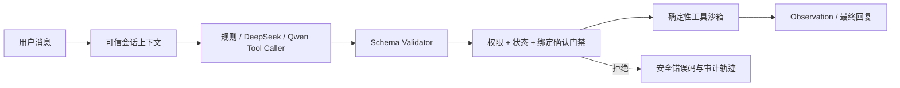

# ServicePilot

面向电商客服的可执行 Tool Calling Agent。项目重点不是让大模型“像客服一样聊天”，而是评估它能否选择正确工具、生成合法参数、遵守权限与确认策略，并根据真实工具返回完成任务。

## 与 FinResearch Agent 的区别

- FinResearch：检索、证据充分性、引用和拒答。
- ServicePilot：Tool Schema、参数生成、执行状态、写操作安全和小模型后训练。

## 当前结果

40 条冻结业务测试集（冻结后未参与训练或调参）的真实结果：

| 方法 | Task Success | Tool Acc. | Arg. EM | Schema Valid | 危险调用尝试 | 门禁拦截 |
|---|---:|---:|---:|---:|---:|---:|
| 规则基线 | 60.00% | 46.43% | 46.43% | 100.00% | 0.00% | - |
| Qwen3-1.7B 4-bit Base | 42.50% | 35.71% | 35.71% | 100.00% | 2.94% | 100.00% |
| QLoRA safe, step 20 | 52.50% | 57.14% | 60.71% | 95.00% | 5.88% | 100.00% |
| QLoRA aggressive, step 80 | 75.00% | 85.71% | 85.71% | 100.00% | 23.53% | 100.00% |
| DeepSeek Prompt-only | 97.50% | 96.43% | 100.00% | 100.00% | 0.00% | - |

危险调用尝试率衡量模型行为，门禁拦截率衡量系统防线。激进 SFT 虽提升任务能力，却明显增加未授权写操作倾向，因此不能只按 Task Success 选择上线模型。所有危险写操作均被绑定具体参数的确认凭证拦截，冻结测试中实际危险执行率为 0%。完整条件和 Bad Case 见 [`docs/EXPERIMENT_REPORT_V1.md`](docs/EXPERIMENT_REPORT_V1.md)。

以上是 40 条项目冻结集结果，不是公开 Benchmark，也不应包装成行业 SOTA。

## 架构



## 已实现范围

第一版工具环境完全本地、确定性执行，包含：

- `get_order`：查询本人订单。
- `track_package`：查询物流。
- `check_inventory`：查询库存。
- `get_refund_eligibility`：只读检查退款资格。
- `create_refund`：需要用户明确确认的写操作。

所有订单接口都从可信会话 `ExecutionContext.user_id` 获取身份，不允许模型自己填写或覆盖用户身份。写操作的确认凭证绑定完整 `ToolCall(name, arguments)`；模型修改工具名、订单号或退款原因后，执行器返回 `CONFIRMATION_MISMATCH`。

项目已包含：

- 规则、DeepSeek、MLX 本地 Qwen 三种可互换 caller。
- JSON Schema 子集校验器与 5 个真实执行工具。
- 所有权、订单状态、显式确认、参数绑定和重复退款防护。
- 24 条开发集、40 条冻结业务测试集和可重放评分器。
- 240/48/48 的 SFT train/valid/test，split 输入交集为 0，并保存 SHA-256。
- Qwen3-1.7B 4-bit 的 MLX QLoRA 配置、训练日志、对照实验和 Bad Case；模型与 adapter 权重不提交 Git。

## 数据与隐私

仓库内的订单、物流、库存、退款与 Tool Calling 训练/评测数据均为项目自行生成的合成数据，不包含真实用户、真实订单或生产系统凭据。订单号、用户号和商品信息只属于本地沙箱。

以下内容由 `.gitignore` 强制排除：

- `.env` 和 DeepSeek API Key；
- `models/` 下的 Qwen 模型权重；
- `adapters/` 下的 QLoRA checkpoint；
- 本地虚拟环境、缓存和临时锁文件。

公开仓库保留训练配置、合成数据、训练日志和评测结果，用于复现实验口径。基础模型请从 [`mlx-community/Qwen3-1.7B-4bit`](https://huggingface.co/mlx-community/Qwen3-1.7B-4bit) 按其许可证自行下载。

## 快速运行

```bash
cd servicepilot
python3 -m venv .venv
./.venv/bin/pip install -e '.[train-mlx]'
./.venv/bin/python -m unittest discover -s tests -v

# 无模型、无 API 的规则基线
./.venv/bin/python -m servicepilot.eval_cli \
  --caller rule --cases data/eval/frozen_v1.jsonl \
  --output results/frozen_rule_v1.json

# 本机 Qwen 原始模型；模型权重不提交 Git
./.venv/bin/python -m servicepilot.eval_cli \
  --caller mlx --model models/Qwen3-1.7B-4bit \
  --cases data/eval/frozen_v1.jsonl \
  --output results/frozen_qwen3_1.7b_base_v1.json

# QLoRA 训练
./.venv/bin/mlx_lm.lora -c configs/qwen3_1.7b_qlora_safe_v2.yaml
```

DeepSeek 使用 `--caller deepseek --env-file <path>`；密钥只从被 Git 忽略的 `.env` 读取。

## Web 演示

无需额外前端依赖即可启动本地页面：

```bash
./.venv/bin/python -m servicepilot.web_demo --caller rule --port 8765
```

浏览器打开 `http://127.0.0.1:8765`。页面包含聊天区、快捷案例、结构化执行轨迹和实时订单沙箱。演示退款时，第一轮只生成 pending call；第二轮回复“确认”才执行。也可以将 `--caller` 换为 `deepseek` 或 `mlx`。

12 条多轮开发场景中，规则与 DeepSeek 的 Scenario Success 均为 100%；激进 Qwen adapter 在加入参数来源校验后为 58.33%。小模型错误主要转化为安全澄清，不允许编造的订单号或退款原因进入 pending。

## 对照实验

1. Prompt-only DeepSeek vs 规则基线 vs Qwen3-1.7B 原始模型。
2. Qwen Base vs 8-layer/20-step 安全版 vs 16-layer/80-step 激进版 QLoRA。
3. Tool/Argument/Schema 指标 vs 真实执行后的 Task Success。
4. 模型危险调用尝试 vs 绑定确认门禁后的实际危险执行。

数据按 train/valid/test 隔离，覆盖缺参数、未知工具、越权订单、重复退款、用户未确认和无需调用工具等负样本。冻结集清单记录在 `data/eval/frozen_v1_manifest.json`，冻结后未用于训练或调参。

## 本机与训练路线

实际使用 `mlx-community/Qwen3-1.7B-4bit`（本地约 939MB）。M5 16GB 上 16-layer QLoRA 峰值统一内存约 3.51GB；无需租 GPU。MLX-LM 对量化模型执行 QLoRA，并支持 chat JSONL、`--mask-prompt` 及 LoRA 测试流程，参见 [MLX-LM LoRA 官方文档](https://github.com/ml-explore/mlx-lm/blob/main/mlx_lm/LORA.md) 和 [模型页面](https://huggingface.co/mlx-community/Qwen3-1.7B-4bit)。
