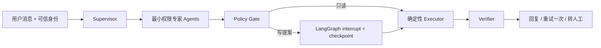

# ServicePilot

基于 LangGraph 与 QLoRA 的受控多智能体客服系统。项目重点不是让大模型“像客服一样聊天”，而是让 Supervisor 和最小权限专家在持久化状态中完成复合任务，并保证任何真实写操作都经过确定性权限、确认绑定与幂等门禁。

V1 `ServiceSession` 与全部冻结结果继续保留为 A0 基线。V2 新增 `GraphServiceSession`、Supervisor、Order/Inventory/Refund 专家、Verifier、LangGraph `interrupt/resume`、SQLite checkpoint 和稳定 `thread_id`。架构细节见 [`docs/LANGGRAPH_ARCHITECTURE.md`](docs/LANGGRAPH_ARCHITECTURE.md)。

V3 已新增冲突感知、作用域隔离的 SQLite 长期记忆，并将 `memory_read`/`memory_write` 接入 Graph；同时接入真实 Mem0 1.0.11 + 本地 Qdrant，以及可重放的脱敏 JSONL/Langfuse v4 Trace。全量测试 69 项通过。14 条 frozen 记忆子系统矩阵中，M3 Mem0 为 50.00%，叠加治理层的 M4 为 92.86%，自研 M6 为 92.86%。M7 使用官方 Evo-Harness workspace/observer 合同与本地 Context-to-Harness 编译器，经过两轮 dev Gate 将相关性阈值演化为 0.075，held-out 与 frozen 均达到 100%；该结果只代表作者构造的记忆子系统事件集，不是小模型端到端能力。四个 40-step 窄职责 Adapter 在独立合成 test 上合计 exact match 从 12.50% 提到 70.83%。详见 [`docs/MEMORY_IMPLEMENTATION_V3.md`](docs/MEMORY_IMPLEMENTATION_V3.md)。

## 与 FinResearch Agent 的区别

- FinResearch：检索、证据充分性、引用和拒答。
- ServicePilot：Tool Schema、参数生成、执行状态、写操作安全和小模型后训练。

## 冻结 V2 结果

V2 已冻结 61 条场景（SHA-256 `b4e1b192...c196a36`），覆盖单专家、复合任务、确认/取消/重启/过期、越权、否定指令和工具故障。规则后端的 A0—A4 同集消融如下：

| 系统 | Scenario Success | 路由 Macro-F1 | 拆解覆盖 | 复合任务 | 重启恢复 | 实际危险执行 |
|---|---:|---:|---:|---:|---:|---:|
| A0：V1 Python 状态机 | 26.23% | 0.00% | 55.46% | 0.00% | 0.00% | 0 |
| A1：单 Agent + LangGraph | 26.23% | 0.00% | 57.10% | 0.00% | 0.00% | 0 |
| A2：Supervisor + Experts | 88.52% | 100.00% | 99.45% | 97.06% | 0.00% | 0 |
| A3：A2 + Verifier | 98.36% | 100.00% | 99.45% | 97.06% | 0.00% | 0 |
| A4：A3 + SQLite HITL | 100.00% | 100.00% | 100.00% | 100.00% | 100.00% | 0 |

A4 的 100% 是确定性编排与安全上限，不是小模型泛化结果。同一 A4 图上的真实本地 Qwen 盲测：

| Caller | Scenario Success | Route Acc. | 拆解覆盖 | 复合任务 | P95 |
|---|---:|---:|---:|---:|---:|
| Qwen3-1.7B 4-bit Base | 29.51% | 47.54% | 43.17% | 8.82% | 2.92 s |
| V1 safe QLoRA | 14.75% | 27.87% | 29.51% | 2.94% | 4.60 s |
| V1 aggressive QLoRA | 9.84% | 29.51% | 24.59% | 2.94% | 3.67 s |
| Graph V2 QLoRA | 26.23% | 45.90% | 51.37% | 23.53% | 9.71 s |

Graph V2 训练提高了拆解和复合任务，但总成功率仍低于 Base，确认/恢复也未学会；这个负结果被保留。详细协议、原始文件和 12 个 Bad Case 见 [`docs/FROZEN_EVAL_V2.md`](docs/FROZEN_EVAL_V2.md)。

40 条冻结业务测试集（冻结后未参与训练或调参）的真实结果：

| 方法 | Task Success | Tool Acc. | Arg. EM | Schema Valid | 危险调用尝试 | 门禁拦截 |
|---|---:|---:|---:|---:|---:|---:|
| 规则基线 | 60.00% | 46.43% | 46.43% | 100.00% | 0.00% | - |
| Qwen3-1.7B 4-bit Base | 42.50% | 35.71% | 35.71% | 100.00% | 2.94% | 100.00% |
| QLoRA safe, step 20 | 52.50% | 57.14% | 60.71% | 95.00% | 5.88% | 100.00% |
| QLoRA aggressive, step 80 | 75.00% | 85.71% | 85.71% | 100.00% | 23.53% | 100.00% |
| DeepSeek Prompt-only | 97.50% | 96.43% | 100.00% | 100.00% | 0.00% | - |

危险调用尝试率衡量模型行为，门禁拦截率衡量系统防线。激进 SFT 虽提升任务能力，却明显增加未授权写操作倾向，因此不能只按 Task Success 选择上线模型。所有危险写操作均被绑定具体参数的确认凭证拦截，冻结测试中实际危险执行率为 0%。完整条件和 Bad Case 见 [`docs/EXPERIMENT_REPORT_V1.md`](docs/EXPERIMENT_REPORT_V1.md)。

以上是 40 条项目冻结集结果，不是公开 Benchmark，也不应包装成行业 SOTA。

## 架构



## 已实现范围

底层工具环境完全本地、确定性执行，包含：

- `get_order`：查询本人订单。
- `track_package`：查询物流。
- `check_inventory`：查询库存。
- `get_refund_eligibility`：只读检查退款资格。
- `propose_refund`：Refund Agent 的无副作用退款提案。
- `create_refund`：需要用户明确确认的写操作。

所有订单接口都从可信会话 `ExecutionContext.user_id` 获取身份，不允许模型自己填写或覆盖用户身份。写操作的确认凭证绑定完整 `ToolCall(name, arguments)`；模型修改工具名、订单号或退款原因后，执行器返回 `CONFIRMATION_MISMATCH`。

项目已包含：

- 规则、DeepSeek、MLX 本地 Qwen 三种可互换 caller。
- JSON Schema 子集校验器、5 个真实业务工具与 1 个无副作用退款提案工具。
- 所有权、订单状态、显式确认、参数绑定和重复退款防护。
- 24 条 V1 开发集、40 条 V1 冻结集、61 条 V2 冻结场景和可重放评分器。
- 240/48/48 的 SFT train/valid/test，split 输入交集为 0，并保存 SHA-256。
- 340 条多角色 Graph SFT V2 数据（255/42/43），与冻结场景消息精确重合为 0。
- Qwen3-1.7B 4-bit 的 MLX QLoRA 配置、真实训练摘要、对照实验和 Bad Case；模型与 adapter 权重不提交 Git。

## 数据与隐私

仓库内的订单、物流、库存、退款与 Tool Calling 训练/评测数据均为项目自行生成的合成数据，不包含真实用户、真实订单或生产系统凭据。订单号、用户号和商品信息只属于本地沙箱。

以下内容由 `.gitignore` 强制排除：

- `.env` 和 DeepSeek API Key；
- `models/` 下的 Qwen 模型权重；
- `adapters/` 下的 QLoRA checkpoint；
- 本地虚拟环境、缓存和临时锁文件。

公开仓库保留训练配置、合成数据、训练日志和评测结果，用于复现实验口径。基础模型请从 [`mlx-community/Qwen3-1.7B-4bit`](https://huggingface.co/mlx-community/Qwen3-1.7B-4bit) 按其许可证自行下载。

## 快速运行

```bash
cd servicepilot
python3 -m venv .venv
./.venv/bin/pip install -e '.[train-mlx,dev]'
./.venv/bin/python -m pytest -q

# 生成并校验 61 条冻结场景
./.venv/bin/python -m servicepilot.graph_data_v2

# A0—A4 确定性消融
./.venv/bin/python -m servicepilot.graph_eval_cli \
  --cases data/eval/graph_frozen_v2.jsonl --variant all \
  --output results/graph_rule_ablation_frozen_v2.json

# V3 记忆治理验收（无模型、无网络）
PYTHONPATH=src ./.venv/bin/python -m servicepilot.memory_eval_cli \
  --output results/memory_v3_governance_eval.json

# M0—M6 同集记忆子系统消融
./.venv/bin/python -m servicepilot.memory_ablation_v3 --split dev
./.venv/bin/python -m servicepilot.memory_ablation_v3 --split heldout

# 本地执行 M7 Evo-Harness Context-to-Harness 演化
./.venv/bin/pip install -e '.[evo]'
HF_HUB_OFFLINE=1 TRANSFORMERS_OFFLINE=1 ./.venv/bin/python \
  -m servicepilot.evo_m7 --max-cycles 3

# 四个窄职责数据集与独立 test 评测
./.venv/bin/python -m servicepilot.narrow_sft_v3
./.venv/bin/python -m servicepilot.narrow_eval_v3

# 生成多角色 Graph SFT 数据并训练
./.venv/bin/python -m servicepilot.graph_sft_v2
./.venv/bin/mlx_lm.lora -c configs/qwen3_1.7b_graph_qlora_v2.yaml

# 本地模型冻结盲测
./.venv/bin/python -m servicepilot.graph_eval_cli \
  --cases data/eval/graph_frozen_v2.jsonl --variant A4 --caller mlx \
  --model models/Qwen3-1.7B-4bit \
  --adapter-path adapters/qwen3_1.7b_servicepilot_graph_v2 \
  --output results/graph_qwen_graph_v2_a4_frozen_v2.json

# 无模型、无 API 的规则基线
./.venv/bin/python -m servicepilot.eval_cli \
  --caller rule --cases data/eval/frozen_v1.jsonl \
  --output results/frozen_rule_v1.json

# 本机 Qwen 原始模型；模型权重不提交 Git
./.venv/bin/python -m servicepilot.eval_cli \
  --caller mlx --model models/Qwen3-1.7B-4bit \
  --cases data/eval/frozen_v1.jsonl \
  --output results/frozen_qwen3_1.7b_base_v1.json

# QLoRA 训练
./.venv/bin/mlx_lm.lora -c configs/qwen3_1.7b_qlora_safe_v2.yaml
```

DeepSeek 使用 `--caller deepseek --env-file <path>`；密钥只从被 Git 忽略的 `.env` 读取。

## Web 演示

无需额外前端依赖即可启动本地页面：

```bash
./.venv/bin/python -m servicepilot.web_demo --caller rule --port 8765 \
  --checkpoint-path data/demo/servicepilot_checkpoints.sqlite
```

浏览器打开 `http://127.0.0.1:8765`。页面显示 active Agent、Supervisor handoff、各 Agent observation、pending payload、thread id、Verifier 结论和实时订单沙箱；“模拟进程重启”会重建 session，并从 SQLite checkpoint 恢复同一 thread。退款第一轮只产生 interrupt，第二轮确认后才进入确定性 Executor。也可以将 `--caller` 换为 `deepseek` 或 `mlx`。

12 条多轮开发场景中，规则与 DeepSeek 的 Scenario Success 均为 100%；激进 Qwen adapter 在加入参数来源校验后为 58.33%。小模型错误主要转化为安全澄清，不允许编造的订单号或退款原因进入 pending。

## 对照实验

1. Prompt-only DeepSeek vs 规则基线 vs Qwen3-1.7B 原始模型。
2. Qwen Base vs 8-layer/20-step 安全版 vs 16-layer/80-step 激进版 QLoRA。
3. Tool/Argument/Schema 指标 vs 真实执行后的 Task Success。
4. 模型危险调用尝试 vs 绑定确认门禁后的实际危险执行。

数据按 train/valid/test 隔离，覆盖缺参数、未知工具、越权订单、重复退款、用户未确认和无需调用工具等负样本。冻结集清单记录在 `data/eval/frozen_v1_manifest.json`，冻结后未用于训练或调参。

## 本机与训练路线

实际使用 `mlx-community/Qwen3-1.7B-4bit`（本地约 939MB）。M5 16GB 上 16-layer QLoRA 峰值统一内存约 3.51GB；无需租 GPU。MLX-LM 对量化模型执行 QLoRA，并支持 chat JSONL、`--mask-prompt` 及 LoRA 测试流程，参见 [MLX-LM LoRA 官方文档](https://github.com/ml-explore/mlx-lm/blob/main/mlx_lm/LORA.md) 和 [模型页面](https://huggingface.co/mlx-community/Qwen3-1.7B-4bit)。
