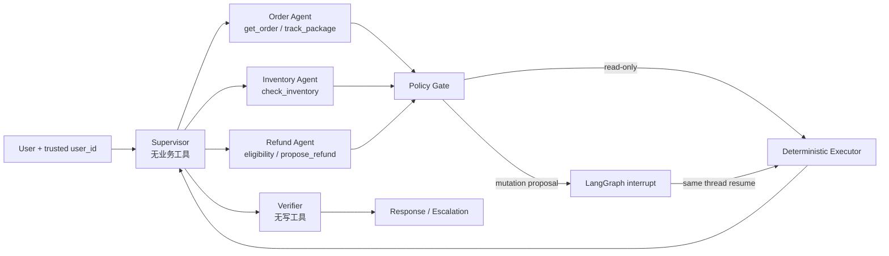

# ServicePilot LangGraph 多 Agent 架构

## 边界

ServicePilot V2 关注多 Agent handoff、最小权限、持久化 HITL 和安全执行，不引入 RAG。V1 `ServiceSession` 保留为 A0；V2 入口是 `GraphServiceSession`。



## Agent 与普通节点

真正的 Agent 只有 Supervisor、Order、Inventory、Refund 和 Verifier。Policy Gate、Executor、checkpointer 与 serializer 是确定性基础设施，不计入 Agent 数量。

| 角色 | 可见工具 | 关键限制 |
|---|---|---|
| Supervisor | 无 | 只拆任务、处理依赖和选择 handoff |
| Order | `get_order`, `track_package` | 看不到库存和退款工具 |
| Inventory | `check_inventory` | 看不到订单和退款工具 |
| Refund | `get_refund_eligibility`, `propose_refund` | 永远看不到 `create_refund` |
| Verifier | 无 | 只检查任务覆盖、工具失败与虚假成功 |

`build_system_prompt(role, allowed_tools, state_policy)` 为模型后端生成独立 prompt 和工具 schema。规则后端使用同一角色边界跑离线回归。

## 状态和图

原始结构化状态定义在 `graph/state.py`，包含 thread、请求、任务队列、当前任务、observation、pending action、handoff trace、重试计数、verification 和最终状态。状态中不保存拼接后的大段 prompt。

图的硬限制：默认最多 6 次 handoff；Verifier 最多要求一次修复；未知或权限错误不自动重试。读工具可直接执行，写动作必须按下面流程：

1. Refund Agent 只能生成 `propose_refund`。
2. Policy Gate 重新校验 schema、ownership 和状态，再转换成 executor-only `create_refund`。
3. pending payload 保存工具、参数、user id、创建时间、版本、SHA-256 binding 和一次性 idempotency key。
4. `interrupt()` 把图停在 checkpoint；恢复必须使用同一 thread id。
5. resume 时再次检查 binding；Executor 用 `confirmed_call` 做 exact ToolCall 校验。
6. `execute_once()` 在 SQLite `BEGIN IMMEDIATE` 事务中写入唯一 idempotency key 和 mutation 结果，重复确认返回原结果。

## 持久化

测试可用 `InMemorySaver`。A4 和本地 Demo 同时使用 `SqliteSaver` 保存图 checkpoint，使用 `SQLiteDemoStore` 保存订单、库存、退款和幂等键：

```bash
.venv/bin/python -m servicepilot.web_demo \
  --caller rule \
  --checkpoint-path data/demo/servicepilot_checkpoints.sqlite
```

页面可查看 active Agent、handoff trace、每个 observation、pending payload、thread id 和 Verifier 结果，并可点击“模拟进程重启”重建 session 后继续确认。

SQLite 高效验证了跨 session/跨进程恢复和唯一幂等事务，但只是单机实现。生产应替换成 PostgreSQL checkpointer 和业务库，并保留 TTL、CAS/版本号、唯一约束与 mutation 同事务。
