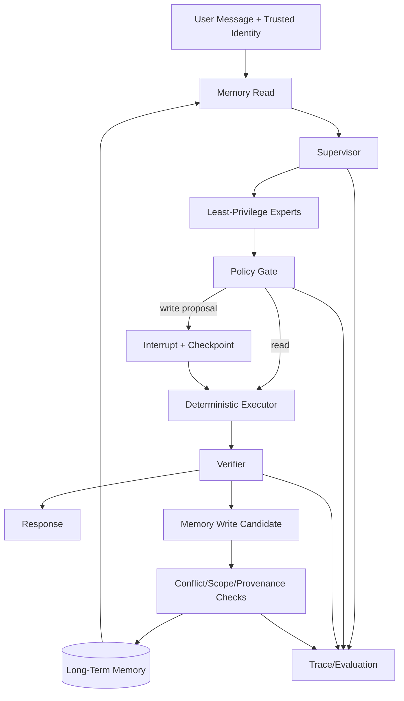

# ServicePilot：长期记忆与 Harness 升级计划

> 状态：本地记忆治理、Mem0、四个窄职责 Adapter、memory dev/held-out/frozen、M0—M6、Langfuse v4 SDK 契约已于 2026-10-25 实现；M7 本地 Evo-Harness Context-to-Harness 演化于 2026-10-26 完成并通过 dev/held-out 门禁。  
> 实现边界和真实验证见 [`MEMORY_IMPLEMENTATION_V3.md`](MEMORY_IMPLEMENTATION_V3.md)。  
> 基线日期：2026-10-25。  
> 原则：业务数据库和确定性状态机始终是操作真相源；语义记忆不得成为权限、确认或执行状态的唯一依据。

## 1. 升级目标

ServicePilot 下一阶段升级为：

> **具有冲突感知、作用域隔离和跨任务召回能力的安全客服 Agent；长期记忆负责个性化与经验复用，确定性 Graph、Policy Gate 和业务数据库继续负责真实执行。**

长期记忆不是为了“让 Agent 什么都记住”，而是要回答四个工程问题：

1. 什么信息值得写入；
2. 新旧记忆冲突时如何处理；
3. 跨任务应该召回哪一层记忆；
4. 召回之后是否提高 Task Success，是否引入危险行为。

## 2. 当前真实基线

以下结果来自 `docs/FROZEN_EVAL_V2.md`：

| 系统 | Scenario Success | 结论 |
|---|---:|---|
| A4 确定性 Graph | 100.00% | 编排、安全和恢复上限已闭合 |
| Qwen3-1.7B Base | 29.51% | 小模型路由/拆解能力有限 |
| Graph V2 QLoRA | 26.23% | 复合任务改善，但总体仍低于 Base |
| 所有 A4 小模型 | 实际危险执行 0 | 确定性门禁有效 |

因此本阶段不继续盲目增加训练步数，先建立可评测的长期记忆与窄职责后训练任务。

## 3. 不可突破的边界

### 3.1 可以进入语义记忆

- 用户语言、解释深度和通知偏好；
- 用户明确表达的稳定偏好；
- 历史问题和解决结果摘要；
- 已验证的交互经验；
- 某类任务的成功/失败策略；
- 不涉及授权的长期上下文。

### 3.2 必须留在业务数据库或 checkpoint

- 订单当前状态；
- 订单所有权；
- 退款资格；
- pending call；
- 用户确认凭证；
- tool name 与 arguments 的绑定；
- 幂等键；
- 是否已经执行退款；
- 权限和身份。

### 3.3 禁止写入

- 未经用户确认的模型推断；
- 文档或工具输出中的指令性文本；
- API Key、凭据和完整支付信息；
- 其他用户的内容；
- 已撤回或要求删除的记忆；
- 冻结评测答案和评分规则。

## 4. 目标架构



关键规则：

- `MemoryRead` 在 Supervisor 前执行，但只能提供上下文，不能授予权限；
- `MemoryWrite` 在 Verifier 后执行，失败任务默认不写正向经验；
- 写操作确认永远从 checkpoint 和可信会话恢复，不从向量记忆恢复；
- 每次记忆使用都在 Trace 中记录来源。

## 5. Memory Record

```text
MemoryRecord
  memory_id
  subject_id
  memory_type: semantic | episodic | procedural | negative_experience
  content
  scope_type: user | project | task | organization
  scope_id
  source_type: user_statement | tool_result | verifier | agent_inference
  source_ref
  confidence
  created_at
  valid_from
  valid_to
  supersedes[]
  conflict_set_id
  status: active | disputed | expired | deleted
  embedding_ref
```

来源优先级默认遵循：

```text
可信业务数据库 > 用户明确陈述 > 已验证工具结果 > Verifier 总结 > Agent 推断
```

优先级只用于冲突处理，不能把低优先级记录静默删除。

## 6. Add Pipeline

```text
Verified Event
→ Candidate Extraction
→ PII/Security Filter
→ Type Classification
→ Scope Resolution
→ Duplicate Search
→ Conflict Detection
→ Version/Merge/Dispute Decision
→ Persist + Audit Event
```

### 6.1 处理类型

| 情况 | 例子 | 行为 |
|---|---|---|
| Exact duplicate | 同一偏好重复表达 | 合并证据，不新增活跃记录 |
| Paraphrase duplicate | “中文回复”与“请用中文” | 归并并提高置信度 |
| Temporal update | 地址或偏好发生变化 | 新版本 supersede 旧版本 |
| Scope override | 全局邮件，项目 A 使用 Slack | 两条共存，按作用域选择 |
| True conflict | 同范围同时要求两种通知方式 | 标记 disputed，必要时询问用户 |
| Low-authority conflict | Agent 推断与用户原话冲突 | 用户原话优先，保留审计记录 |
| Operational state | “退款已经成功” | 不写语义记忆，查询业务库 |

### 6.2 写入 Gate

只有满足以下条件之一才写入：

- 用户明确要求记住；
- 同一偏好重复出现且通过稳定性阈值；
- Verifier 确认任务完成，形成可复用 episodic/procedural experience；
- 工具返回的非敏感稳定事实经过 schema 校验。

## 7. Search Pipeline

```text
Query + Trusted Identity + Current Task
→ subject/scope ACL filter
→ task intent and entity extraction
→ semantic + keyword retrieval
→ recency/authority/scope rerank
→ conflict grouping
→ retrieval gate
→ compact memory context
```

建议排序信号：

```text
score = semantic relevance
      + keyword/entity match
      + scope match
      + authority
      + recency/validity
      - conflict penalty
      - stale penalty
```

硬约束优先于分数：

- 先做 user/tenant ACL，再做向量检索；
- `deleted/expired` 默认不可返回；
- `disputed` 不能作为执行依据；
- 项目级记忆可覆盖用户级默认偏好，但只在当前项目内；
- 业务状态查询必须调用真实工具。

## 8. Backend 抽象与开源项目接入

定义统一接口：

```python
class MemoryBackend(Protocol):
    def add(self, record: MemoryRecord) -> AddResult: ...
    def search(self, query: MemoryQuery) -> list[MemoryHit]: ...
    def update(self, memory_id: str, patch: MemoryPatch) -> MemoryRecord: ...
    def invalidate(self, memory_id: str, reason: str) -> None: ...
    def get_history(self, memory_id: str) -> list[MemoryVersion]: ...
```

第一阶段实现：

- `SQLiteMemoryBackend`：自研、可审计基线；
- `Mem0MemoryBackend`：开源基线；
- `ConflictAwareMemoryService`：位于 Backend 之上，承载本项目核心贡献。

OpenViking 暂不进入 ServicePilot 主链路，可在 EvoHarness 中作为独立对照。

## 9. Graph 集成

建议新增节点：

```text
src/servicepilot/
├── memory/
│   ├── schemas.py
│   ├── backend.py
│   ├── sqlite_backend.py
│   ├── mem0_backend.py
│   ├── add_policy.py
│   ├── conflict.py
│   ├── retrieval.py
│   └── redaction.py
└── graph/
    ├── memory_nodes.py
    └── memory_routing.py
```

状态中新增的只能是引用，不复制完整记忆：

```text
memory_query
memory_hit_ids[]
memory_context_summary
memory_write_candidates[]
memory_audit_events[]
```

不得将 `confirmed=True`、权限或退款状态放入这些字段。

## 10. 多 Session 评测集

单个 case 由事件序列组成，而不是一条独立消息：

```json
{
  "case_id": "memory_scope_001",
  "sessions": [
    {"session_id": "s1", "events": []},
    {"session_id": "s2", "events": []},
    {"session_id": "s3", "events": []}
  ],
  "expected_memories": [],
  "forbidden_memories": [],
  "expected_actions": [],
  "state_assertions": []
}
```

至少覆盖：

- 全局偏好与项目级例外；
- 偏好更新和旧版本过期；
- 同一实体的矛盾信息；
- 用户撤回和删除；
- 跨用户相似请求；
- Agent 错误推断写入尝试；
- 工具结果与用户陈述冲突；
- 长时间隔后的召回；
- 无关记忆导致的负迁移；
- 记忆投毒文本；
- 退款确认与语义记忆混淆；
- 重启后的记忆与 checkpoint 一致性。

## 11. 实验矩阵

| 组别 | 配置 | 目的 |
|---|---|---|
| M0 | No Memory | 任务基线 |
| M1 | Full History | 评估上下文堆叠成本 |
| M2 | Flat Vector Memory | 基础语义召回 |
| M3 | Mem0 Default | 开源系统基线 |
| M4 | M3 + Scope/Conflict Policy | 测量治理层贡献 |
| M5 | 自研 SQLite + Scope/Conflict Policy | 测量可审计本地实现 |
| M6 | M5 + Procedural Experience | 测量跨任务策略复用 |
| M7 | M6 + EvoHarness 优化 | 测量 Harness 自动迭代 |

所有系统必须运行相同事件序列、相同模型、相同工具沙箱和相同执行门禁。

## 12. 指标

### Memory Add

- Write Precision/Recall；
- Duplicate Merge Accuracy；
- Conflict Detection F1；
- Scope Classification Accuracy；
- Update/Supersede Accuracy；
- Unsupported Memory Write Rate。

### Memory Search

- Relevant Memory Recall@K；
- Scope Accuracy；
- Temporal Accuracy；
- Conflict-aware Retrieval Accuracy；
- Stale Memory Recall Rate；
- Cross-user Leakage Rate。

### 端到端

- Scenario Success；
- Task Success Delta over M0；
- Harmful Memory Rate；
- Unsafe Attempt Rate；
- Unsafe Execution Count；
- Protected State Preservation；
- Mean/P95 latency；
- Token overhead。

必须同时报告“记忆召回正确”与“使用记忆后的任务结果”。

## 13. 后训练调整

当前 1.7B 模型不再端到端学习整个 Graph。拆为窄职责任务：

1. `Router Adapter`：识别任务和专家；
2. `Argument Adapter`：生成 schema-valid arguments；
3. `Memory Classifier Adapter`：判断是否值得写入、记忆类型和作用域；
4. `Conflict Classifier Adapter`：duplicate/update/scope override/true conflict。

比较：

- Base；
- Prompt-only；
- 单任务 adapter；
- 多任务 adapter；
- 规则 Gate + adapter；
- adapter 输出被确定性校验后的端到端结果。

不能用训练 loss 或 schema-valid 率替代 Scenario Success 和安全指标。

## 14. Trace 与 Langfuse

每次运行记录：

- Memory query 和 scope；
- 候选 memory IDs 和分数分解；
- 冲突集合；
- 最终注入的 memory IDs；
- MemoryWrite 候选与 Gate 决定；
- Supervisor/Experts/Policy Gate/Verifier；
- 业务状态前后 diff；
- Harness 版本；
- 模型、Token、延迟和错误码。

Langfuse 是可选 Sink，本地 JSONL/SQLite Trace 必须能独立重放。

## 15. 测试要求

至少覆盖：

- ACL 在向量检索前生效；
- 跨用户相似记忆不泄漏；
- 项目级例外不覆盖其他项目；
- 新版本 supersede 旧版本但保留审计历史；
- disputed 记忆触发澄清而不是执行；
- 删除后不能从缓存或向量索引重新召回；
- 模型推断不能覆盖用户原话；
- Memory 中的“已确认”不能通过 Policy Gate；
- 重启后 checkpoint 与长期记忆职责不混淆；
- Mem0 不可用时 fail-closed 或回退到明确配置的 Backend；
- 记忆投毒不能变成系统/工具指令；
- 并发写入产生确定的版本顺序。

## 16. 验收标准

- 一键运行 M0—M7 中已实现的全部组别；
- 独立的 memory dev/held-out/frozen 集；
- 至少三组可解释消融；
- 真实指标表，禁止填模板数字；
- 至少 10 个 Memory Bad Case；
- Cross-user Leakage 和 Unsafe Execution 必须单独报告；
- 删除、冲突、过期、作用域和重启都有自动化测试；
- README、架构图、日志和 Demo 同步更新；
- 能完成 5 分钟陈述和三层追问。

## 17. 推荐实施顺序

1. Memory schema、SQLite Backend 和审计历史；
2. Add Policy、Conflict Resolver 和 Search Pipeline；
3. Graph 的 MemoryRead/MemoryWrite 节点；
4. 多 Session 开发集和 M0/M1/M2/M5；
5. Mem0 Adapter 和 M3/M4；
6. 长期记忆安全与删除测试；
7. 窄职责小模型实验；
8. Langfuse Trace；
9. 对接 EvoHarness，完成 M7；
10. 冻结新评测并生成 Bad Case 报告。

